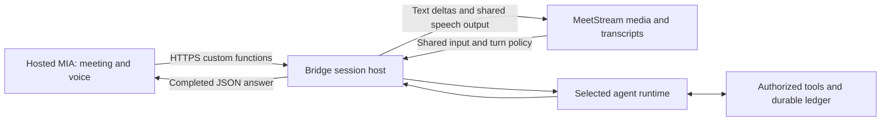

# Universal Agent Adapter SDK

Connect a MeetStream MIA agent to **OpenAI Agents SDK, Google ADK, CrewAI or LangGraph**, and switch between them during a meeting. The bridge handles runtime selection, shared tools, cancellation and conversation context. MeetStream retains meeting presence, audio transport and chat. The default bridge shares one speech pipeline across all runtimes; hosted MIA tool mode retains its existing voice pipeline.

## Scope 

Build one standard adapter layer instead of a bespoke bridge for every framework, generalizing the integration approach used for Hermes, OpenClaw and Grok. The initial integrations are **OpenAI Agents SDK, Google ADK, CrewAI and LangGraph**; those earlier integrations are context, not additional adapters in this release. Each external framework runs its reasoning and tools behind one common transport and tool interface. This pilot supplies bounded shared conversation history; framework-private checkpoints and persistent memory are not retained between turns or migrated between runtimes.

The deliverables are a framework-neutral adapter contract, reference runtime adapters, streaming turns, tool calls, cancellation and error handling, authentication/deployment guidance, and end-to-end voice demos. The acceptance target is the same MIA meeting application switching between at least two runtimes through configuration alone while preserving streaming, tool calls and interruption. The implementation is operated as a local pilot without MIA backend changes; see [architecture](docs/architecture.md) and [deployment guidance](docs/deployment.md).

## Start and stop

Install [Node.js with npm](https://nodejs.org/) and the current [uv](https://docs.astral.sh/uv/getting-started/installation/) (0.13.4 or newer) once. Open a terminal in this project folder:

```sh
npm start
```

The default is the local streaming meeting pilot: Google-backed ADK on a fresh installation and shared Deepgram speech through MeetStream's existing external-agent connection. Later starts reuse the last startup selection. All four runtimes are enabled by default. Dependencies install automatically; no `npm install` or separate Python installation is needed. First startup can take several minutes. Missing credentials for the selected setup are entered privately and saved in the project's `.env` file. Subsequent starts reuse them. No MIA backend patch or hosted model integration is required for this streaming path.

For a pilot that can switch between **all four runtimes**, start with:

```sh
npm start -- --runtime adk
```

| Credential | Purpose |
|---|---|
| `MEETSTREAM_API_KEY` | Meeting bot, media transport and chat |
| `OPENAI_API_KEY` | Native OpenAI Agents SDK |
| `GOOGLE_API_KEY` | Google ADK and the pilot's Google-backed CrewAI/LangGraph |
| `DEEPGRAM_API_KEY` | Shared transcription and speech in default streaming meeting mode |
| `NGROK_AUTHTOKEN` | Public connection to the local bridge; unnecessary with a configured fixed HTTPS address |

The full four-runtime setup needs both model keys. An explicitly Google-only run (`--no-openai`) needs no OpenAI key; an OpenAI-only streaming run needs no Google key. Other model keys are required before switching to their providers. Startup generates private bridge authentication credentials locally. See the [quickstart](quickstart.md) for key links and guided setup.

Press **Ctrl+C** to stop, or run this in another terminal in the same folder:

```sh
npm stop
```

The launcher cancels bridge sessions, makes its owned meeting bot leave and closes its tunnel. The private ledger and ownership records reconcile pending cloud cleanup on `npm stop` or the next start. Repeated stops are safe. Hosted `mia` mode additionally removes its owned agent registration. See the [non-technical quickstart](quickstart.md).

## Workflow

| Mode | What happens | What you provide |
|---|---|---|
| `demo` | Free local check using the test runtime; exits when finished | Nothing |
| `meeting` (default) | Joins one MeetStream bot; streams selected runtime responses through shared speech and chat | Meeting URL, MeetStream/model/Deepgram keys, ngrok token or fixed HTTPS address |
| `mia` | Registers and joins hosted Google MIA with common runtime custom functions | Meeting URL, Google and MeetStream keys, external runtime model key, connected Gemini integration, ngrok token or fixed HTTPS address |
| `service` | Private events service for an application that owns input and output | Model key and an authenticated application client |

For optional hosted MIA, `npm start -- --mode mia` registers the current HTTPS tools and Google voice/routing configuration automatically. Paste your meeting link when asked; startup sends **Adapter MIA Pilot** into that meeting automatically. Admit it if your meeting requires host approval and keep the bridge running. `npm stop` or Ctrl+C makes the bot leave, verifies its departure, then removes its registration. No MeetStream dashboard launch or stop is needed. Each start reconciles the previous owned bot and registration and refreshes the tunnel address; unrelated agents are preserved. MIA calls `delegate_agent`, `switch_agent` and `interrupt_agent`. Both meeting modes support the same four runtimes. No MIA backend patch is required. See [registration lifecycle](docs/runtime-switching.md#hosted-mia-setup).

Choose the starting runtime through configuration:

| Runtime | Startup command | Pilot reasoning provider |
|---|---|---|
| OpenAI Agents SDK | `npm start -- --runtime openai` | OpenAI |
| Google ADK | `npm start -- --runtime adk` | Google |
| CrewAI | `npm start -- --runtime crewai` | Google |
| LangGraph | `npm start -- --runtime langgraph` | Google |

All four runtimes are available with their provider credentials configured. Use `--runtime` to choose the starting runtime and `--model` to override its model. Startup asks privately for missing credentials. During a meeting, say **“Okay assistant, switch to <runtime>.”** In hosted MIA mode, say **“Switch the external agent to <runtime>.”** Provider errors do not trigger automatic fallback.

Reasoning and speech are separate settings. Default `meeting` mode uses shared Deepgram speech; hosted `mia` mode uses MIA's Google-backed voice. Switching runtimes preserves the speech configuration.

In `meeting` mode, admit **Adapter SDK Test**, wait for the connected message and say **“Okay assistant, look up project adapter status.”** To change runtimes, say **“Okay assistant, switch to LangGraph”**, ADK, CrewAI or OpenAI. The same bot stays in the meeting. Only installed runtimes with configured model credentials can be selected.

## Architecture



The two paths share the same adapter contract, runtime switching and tool executor:

- **Adapter:** each framework runs its native asynchronous reasoning/tool loop and emits normalized events.
- **Session host:** one active turn per meeting; bounded common history; ordered streaming events; cancellation fences obsolete output before another runtime takes over.
- **Tool executor:** validated schemas, allowlisted handlers, trusted session scope, deadlines and persistent write receipts. Uncertain writes are never replayed automatically.
- **Transport and output:** authenticated HTTPS/WebSockets and resumable SSE. The media path supplies shared STT/TTS and chat. The default external-agent connection streams incremental speech and uses MeetStream audio/chat transport. Optional hosted MIA custom functions return completed JSON; hosted MIA owns that mode's audible delivery.

Switch preparation checks configuration and capabilities while the current agent remains usable. Commit cancels old work, clears pending bridge playback and closes the old runtime before enabling the replacement. Bot identity, tools, ledger and shared history remain. Private framework checkpoints do not transfer. See [architecture and event contract](docs/architecture.md) and [switching behavior](docs/runtime-switching.md).

## Configuration and deployment

All four frameworks use Python 3.12–3.13. npm is a command shortcut; the project has no npm dependencies. Guided startup installs all four runtimes and starts with ADK on a fresh installation. Embedded and container deployments can install only the framework extras they need. Configure credentials for each provider you intend to use.

The supplied tools are sandbox examples: project lookup, local action items and meeting chat. Applications supply their own authorized `ToolSpec` handlers for production integrations. [SDK embedding examples](docs/native-mia.md) cover Python and JavaScript clients.

For an unattended deployment, configure `.env`, stable HTTPS and persistent storage, then run:

```sh
docker compose up -d --build
# Stop the deployment; keep its persistent ledger.
docker compose down
```

Compose runs as a non-root user, checks readiness, persists the ledger and binds port 8080 to loopback. Its default configuration is the events-only MIA tool service. Route `/mia/` through your HTTPS proxy; keep management routes private. Docker lifecycle is independent of `npm stop`. See [deployment and authentication](docs/deployment.md).

## Development

See [developer verification](docs/validation.md#developer-commands), [runtime compatibility](docs/compatibility.md), and [voice demos](docs/demos.md). The [deployment guide](docs/deployment.md) covers authentication, containers and hosting.

Without Node.js, use a current uv installation: `uv run --frozen --all-extras --no-extra dev meetstream-adapter start`. After setup, stop without installing or updating dependencies using `uv run --no-sync meetstream-adapter stop`. Desktop launchers use the same Node.js/uv prerequisites as npm: `start.command` on macOS, `start.bat` on Windows, or `sh start.command` on Linux.
